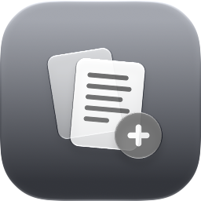

<p align="center"></p>

# PDF Merge

A small native macOS app for merging PDFs and images into one PDF. Built with SwiftUI and PDFKit, with Liquid Glass controls on macOS 26+. It runs on macOS 14+ as a universal app (Apple Silicon and Intel) of about 4 MB, with no third-party dependencies.

## Install

Download the DMG from [Releases](../../releases), open it, and drag **PDF Merge** to **Applications**.

The app isn't signed with an Apple Developer ID, so macOS blocks the first launch. Go to **System Settings → Privacy & Security** and click **Open Anyway**. After that it opens normally.

## Features

- Add PDFs and images (PNG, JPEG, HEIC, TIFF, GIF, BMP, WebP) by drag and drop, with the Add Files button, or as a whole folder.
- Drag rows to reorder. Sort by name or reverse the order from the ☰ menu or the List menu.
- Set a page range for each file, e.g. `1-3, 5, 8-`, or `5-1` for reverse order.
- Asks for the password when a PDF is encrypted.
- **Keep original size**: copies pages as they are, so links and annotations survive.
- **Standardize page size**: scales each page to fit Letter, Legal, Tabloid, A3, A4, A5, B5 or a custom size, centered, in portrait or landscape. Content stays vector and the text stays selectable.
- The gear icon switches units: in, mm, cm or pt.
- A light/dark switcher in the window; the app follows the system until you choose.
- A Liquid Glass app icon that adapts to the Default, Dark, Clear and Tinted icon styles.
- Shortcuts: ⌘O add files, ⇧⌘O add folder, ⌘↩ merge.

## Build

```bash
./scripts/build.sh            # builds dist/PDF Merge.app
./scripts/build.sh --install  # builds and moves it into /Applications
./scripts/make_dmg.sh         # builds dist/PDF Merge <version>.dmg
```

Xcode builds against the latest SDK and compiles the layered Liquid Glass icon from `Resources/AppIcon.icon`. The Command Line Tools alone are enough too. In that case the script builds against the macOS 26.x SDK and the app falls back to the flat `AppIcon.icns`.

The icon artwork is generated by `scripts/make_icon.swift`.
